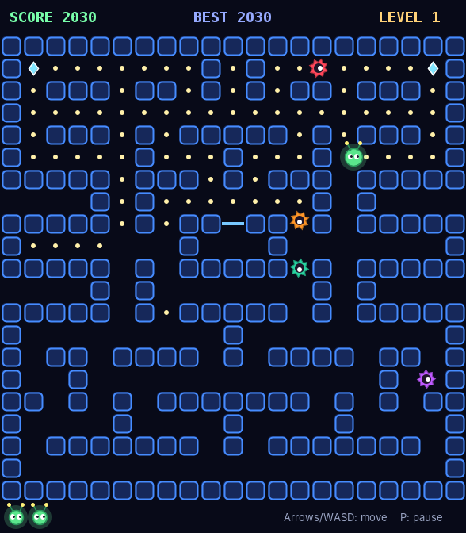
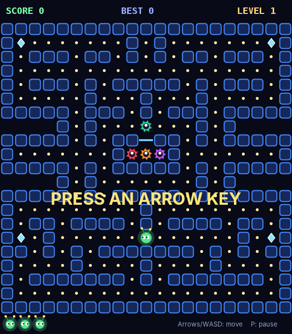
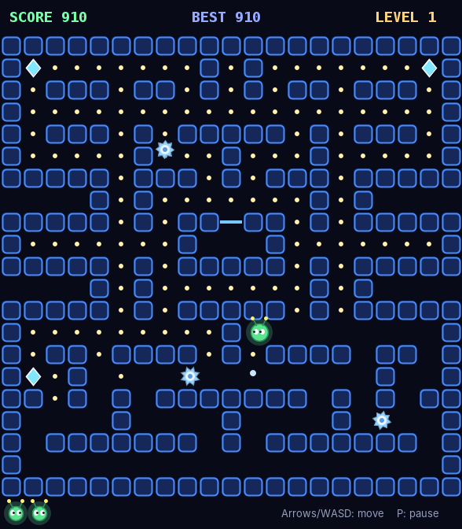
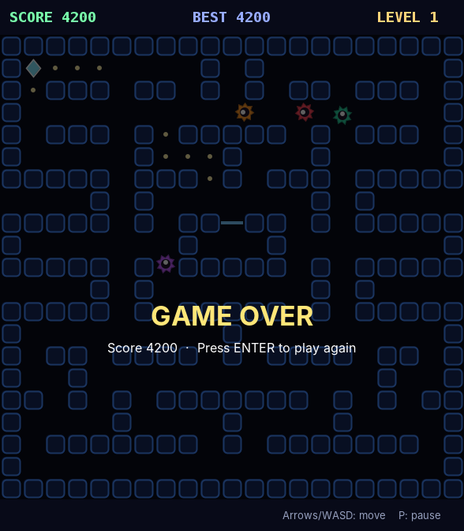

# Glowbug Maze

An original arcade maze-chase game written in plain Java with Swing. You play **Glowbug**, a little glowing bug-bot. Collect every energy dot in the maze while four spiky drones hunt you down, and grab a **freeze crystal** to turn the tables and shatter them.

It's one source file and needs no external libraries.



## Features

- Smooth movement, with buffered turns that you can press just before a corner
- **Four drones, each with its own behaviour:**
  - 🔴 **Hunter** heads straight for you
  - 🟠 **Ambusher** aims for the spot four tiles ahead of you
  - 🟣 **Shy** chases you from far away but backs off when it gets close
  - 🟢 **Wanderer** is half chaser, half random
- **Freeze crystals** turn every drone icy blue and slow them down. Touch a frozen drone to shatter it. Its core flies back to the pen and rebuilds.
- Shattering several drones on one freeze builds a combo: 200 → 400 → 800 → 1600 points
- 3 lives, a game that gets harder each level, and your best score for the session
- Pause and quick restart

## Screenshots

| Start | Gameplay | Freeze crystal active | Game Over |
|---|---|---|---|
|  |  |  |  |

## Controls

| Key | Action |
|---|---|
| Arrow keys / W A S D | Move |
| P | Pause / resume |
| Enter | Play again after game over |

## Scoring

| Item | Points |
|---|---|
| Energy dot | 10 |
| Freeze crystal | 50 |
| Shattered drone | 200, 400, 800, 1600 (combo) |

Clear every dot and crystal to move on to the next level. From level 3 the drones move faster, and the freeze gets shorter on each level.

## Requirements

- Java JDK 8 or newer. Check with `javac -version`.
  - macOS: `brew install openjdk`, or download it from [adoptium.net](https://adoptium.net)
  - Windows / Linux: download it from [adoptium.net](https://adoptium.net)

## How to run

### Option 1: Terminal (any OS)

```bash
git clone https://github.com/neerajR596/glowbug-maze.git
cd glowbug-maze
javac GlowbugMaze.java
java GlowbugMaze
```

### Option 2: Double-click (macOS)

Double-click `run-glowbug.command`. It compiles and launches the game.
If macOS says the file isn't executable, run `chmod +x run-glowbug.command` once.

### Option 3: IDE

Open the folder in IntelliJ IDEA, Eclipse or VS Code (with the Java Extension Pack), open `GlowbugMaze.java`, and run `main`.

> Click once on the game window so it receives your key presses.

## Project structure

```
glowbug-maze/
├── GlowbugMaze.java     # The whole game: maze, AI, input and rendering
├── run-glowbug.command  # macOS launcher that compiles and runs the game
├── screenshots/         # Images used in this README
└── README.md
```

## How it works

- **The maze** is a 21 × 21 text map inside the code (`#` wall, `.` dot, `*` crystal, `-` pen gate). You can change the `MAP` strings to design your own level.
- **Movement** is tile-based, and each tile is split into small steps so the motion looks smooth. When you press a direction, the game remembers it and turns as soon as that path opens up.
- **Drone AI:** at every tile, each drone picks a direction that isn't straight back the way it came, choosing the one that gets it closest to its target tile. Each drone's personality is just a different way of picking that target.
- **The game loop** is a Swing `Timer` running at about 60 FPS. A custom `JPanel` draws everything with `Graphics2D`, including the pulsing crystals, the spinning drones and the player's glow.

## Author

[@neerajR596](https://github.com/neerajR596)
